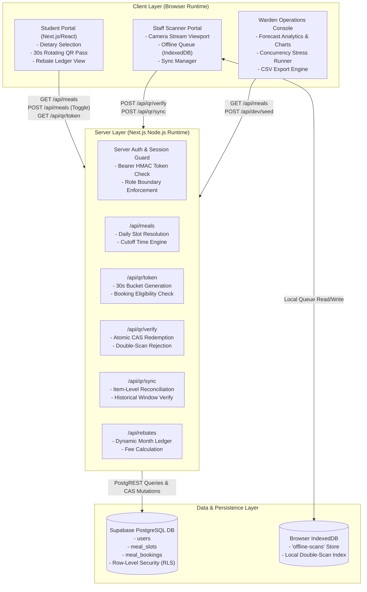
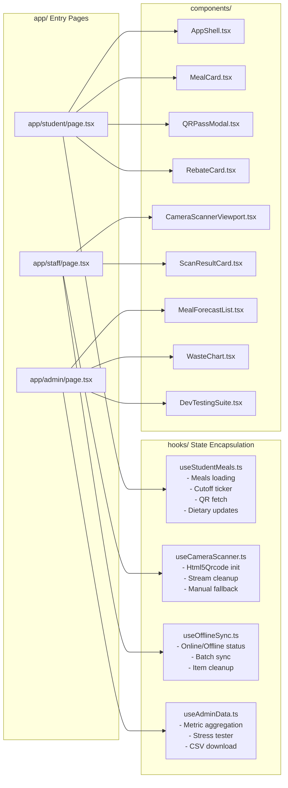
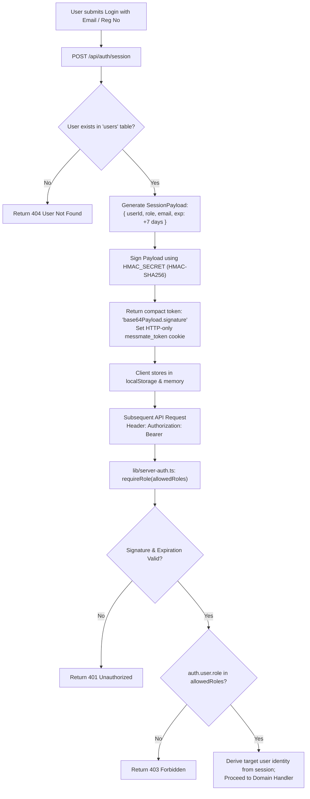
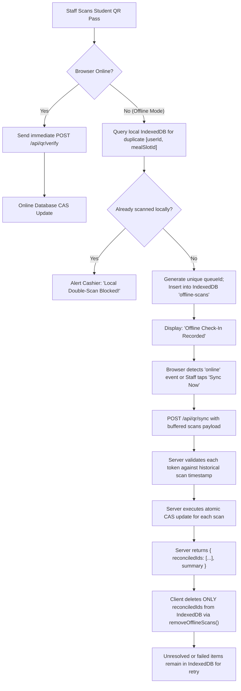
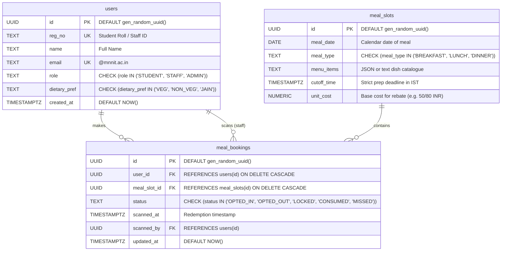

# MessMate — Architecture & System Design

> **Document Focus:** Architectural blueprints, runtime boundaries, component hierarchies, and data-flow sequences.

---

## 1. High-Level Architecture Overview

MessMate operates as a multi-tier web application combining Next.js Server Components, App Router API Route Handlers, a client-side offline caching tier, and a cloud-hosted Supabase PostgreSQL database.



---

## 2. Frontend Component & Module Architecture

MessMate follows a modular composition model where page components (`app/*/page.tsx`) act as lightweight orchestrators delegating business state to custom hooks (`hooks/`) and pure visual layout to reusable components (`components/`).



---

## 3. End-to-End Request & Data-Flow Architecture

This diagram illustrates what happens when an authenticated client triggers a server operation:

```mermaid
sequenceDiagram
    autonumber
    actor Client as Browser Client
    participant AuthContext as AuthProvider (lib/auth.tsx)
    participant Route as API Handler (app/api/*)
    participant Guard as Server Auth (lib/server-auth.ts)
    participant Domain as Domain Service (lib/*)
    participant Database as Supabase DB (PostgreSQL)

    Client->>AuthContext: User action triggered (e.g. Toggle Meal)
    AuthContext->>Route: fetch("/api/meals", { headers: getAuthHeaders(), body })
    Route->>Guard: requireAuthenticatedUser(request)
    Guard->>Guard: Verify HMAC-SHA256 session token & expiration
    Guard-->>Route: Authenticated UserProfile { id, role, email }
    Route->>Domain: Evaluate business rules (e.g. Cutoff check in Asia/Kolkata)
    Domain-->>Route: Cutoff valid (pre-deadline)
    Route->>Database: Atomic SQL UPDATE meal_bookings
    Database-->>Route: Updated booking record
    Route-->>Client: 200 OK { success: true, booking }
    Client->>Client: Optimistic UI confirmed; re-render state
```

---

## 4. Authentication & Role-Based Authorization Flow

MessMate employs cryptographic HMAC-SHA256 session tokens. Identity is never accepted blindly from client query strings or payload IDs.



---

## 5. QR Code Security & Single-Use Redemption Flow

To eliminate buddy scanning, pass reuse, and race conditions between multiple cashiers:

```mermaid
sequenceDiagram
    autonumber
    actor Student as Student Portal
    actor Staff as Staff Cashier Terminal
    participant QRTokenAPI as /api/qr/token
    participant QRVerifyAPI as /api/qr/verify
    participant DB as PostgreSQL DB

    Note over Student,QRTokenAPI: Phase 1: Pass Generation (Every 30s)
    Student->>QRTokenAPI: GET /api/qr/token (with Bearer Token)
    QRTokenAPI->>DB: Check booking exists & status IN ('OPTED_IN', 'LOCKED')
    DB-->>QRTokenAPI: Booking confirmed eligible
    QRTokenAPI->>QRTokenAPI: Generate timeWindow = floor(Date.now() / 30000)
    QRTokenAPI->>QRTokenAPI: Sign `${userId}:${mealSlotId}:${timeWindow}` with HMAC_SECRET
    QRTokenAPI-->>Student: Return { qrToken }
    Student->>Student: Render dynamic QR code on screen

    Note over Staff,DB: Phase 2: Cashier Scanning & CAS Redemption
    Staff->>Staff: Camera scans QR; decodes payload
    Staff->>QRVerifyAPI: POST /api/qr/verify { qrToken } (Bearer Staff Token)
    QRVerifyAPI->>QRVerifyAPI: In-memory crypto check: verify signature & window drift (current or prev bucket)
    QRVerifyAPI->>DB: Atomic Compare-And-Swap (CAS):\nUPDATE meal_bookings\nSET status='CONSUMED', scanned_at=now(), scanned_by=staffId\nWHERE user_id=targetUser AND meal_slot_id=targetSlot\nAND status IN ('LOCKED', 'OPTED_IN')
    alt Exactly 1 row updated (First cashier)
        DB-->>QRVerifyAPI: 1 row affected
        QRVerifyAPI-->>Staff: 200 OK "Pass Verified: Meal Redeemed!"
    else 0 rows updated (Duplicate scan / Already consumed)
        DB-->>QRVerifyAPI: 0 rows affected
        QRVerifyAPI->>DB: SELECT status, scanned_at FROM meal_bookings
        DB-->>QRVerifyAPI: Record shows status='CONSUMED' at 13:14:02
        QRVerifyAPI-->>Staff: 409 Conflict "ALERT: Pass already redeemed! Double-scan rejected."
    end
```

---

## 6. Offline Queue Buffering & Reconnection Flow

During hostel dining rushes, campus Wi-Fi drops must not halt student entry:



---

## 7. Database Entity-Relationship (ER) Schema

MessMate’s actual PostgreSQL relational schema defined in `supabase/migrations/001_init.sql` and `002_security_rls.sql`:



### Constraints & Indexes Implemented
- `meal_slots UNIQUE(meal_date, meal_type)`: Prevents duplicate slots for the same meal period on the same day.
- `meal_bookings UNIQUE(user_id, meal_slot_id)`: Enforces that each student has exactly one booking record per meal slot.
- `idx_bookings_user_slot`: B-tree composite index on `(user_id, meal_slot_id)` guaranteeing sub-50ms check-in lookups.
- `idx_meal_bookings_user_status`: Composite index on `(user_id, status)` for fast monthly rebate ledger aggregation.
