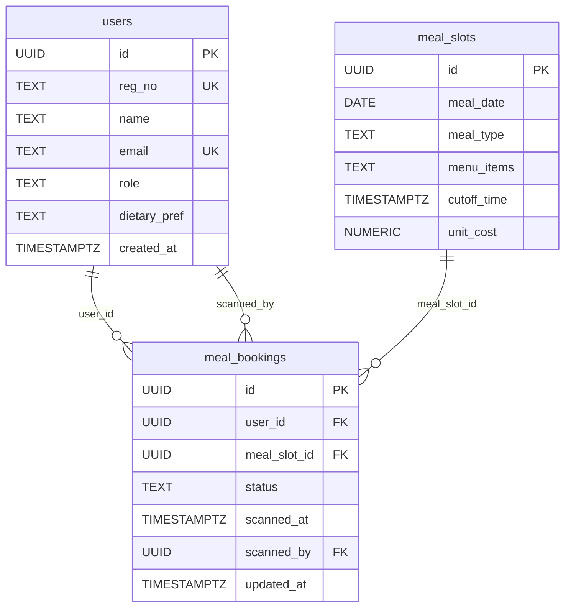
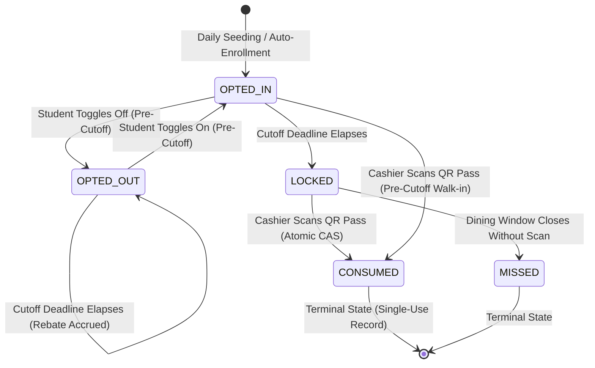

# MessMate — Database Schema & Data Model

> **Document Focus:** Relational architecture, table constraints, lifecycle states, atomic SQL operations, and Row-Level Security (RLS) policies.

---

## 1. Relational Schema Architecture

MessMate's persistence layer is built on PostgreSQL (hosted via Supabase), defined across two migrations:
- `supabase/migrations/001_init.sql`: Core schema, constraints, and indices.
- `supabase/migrations/002_security_rls.sql`: Row-Level Security (RLS) access control policies.



---

## 2. Table Specifications

### 1. `users` Table
Stores registered student, mess staff, and hostel administration identities.

| Column | Type | Constraints | Description |
| :--- | :--- | :--- | :--- |
| `id` | `UUID` | `PRIMARY KEY DEFAULT gen_random_uuid()` | Unique immutable system identifier. |
| `reg_no` | `TEXT` | `UNIQUE NOT NULL` | Student roll number (e.g. `20253137`) or staff badge ID (e.g. `STAFF-01`). |
| `name` | `TEXT` | `NOT NULL` | Full legal or display name. |
| `email` | `TEXT` | `UNIQUE NOT NULL` | Institutional email (restricted to `@mnnit.ac.in`). |
| `role` | `TEXT` | `NOT NULL CHECK (role IN ('STUDENT', 'STAFF', 'ADMIN'))` | Role-based authorization tier. |
| `dietary_pref` | `TEXT` | `DEFAULT 'VEG' CHECK (dietary_pref IN ('VEG', 'NON_VEG', 'JAIN'))` | Preferred dietary preparation variant. |
| `created_at` | `TIMESTAMPTZ` | `DEFAULT NOW()` | Account creation timestamp. |

---

### 2. `meal_slots` Table
Represents daily dining periods and cutoff parameters.

| Column | Type | Constraints | Description |
| :--- | :--- | :--- | :--- |
| `id` | `UUID` | `PRIMARY KEY DEFAULT gen_random_uuid()` | Unique meal slot identifier. |
| `meal_date` | `DATE` | `NOT NULL` | Calendar date (e.g. `2026-10-28`). |
| `meal_type` | `TEXT` | `NOT NULL CHECK (meal_type IN ('BREAKFAST', 'LUNCH', 'DINNER'))` | Dining period. |
| `menu_items` | `TEXT` | `NOT NULL` | Text description or JSON string with `{ VEG: [], NON_VEG: [], JAIN: [] }`. |
| `cutoff_time` | `TIMESTAMPTZ` | `NOT NULL` | Exact server timestamp after which attendance is locked. |
| `unit_cost` | `NUMERIC` | `DEFAULT 50` | Per-meal credit value used for rebate calculation (e.g. ₹40, ₹80, ₹60). |

**Table Constraint:** `UNIQUE(meal_date, meal_type)` prevents multiple slots for the same meal on the same day.

---

### 3. `meal_bookings` Table
The single-use dining ledger linking students to meal slots.

| Column | Type | Constraints | Description |
| :--- | :--- | :--- | :--- |
| `id` | `UUID` | `PRIMARY KEY DEFAULT gen_random_uuid()` | Unique booking record identifier. |
| `user_id` | `UUID` | `REFERENCES users(id) ON DELETE CASCADE` | Foreign key referencing the resident. |
| `meal_slot_id` | `UUID` | `REFERENCES meal_slots(id) ON DELETE CASCADE` | Foreign key referencing the meal slot. |
| `status` | `TEXT` | `NOT NULL DEFAULT 'OPTED_IN' CHECK (status IN ('OPTED_IN', 'OPTED_OUT', 'LOCKED', 'CONSUMED', 'MISSED'))` | Current lifecycle state. |
| `scanned_at` | `TIMESTAMPTZ` | `NULLABLE` | Exact instant cashier verified and redeemed the pass. |
| `scanned_by` | `UUID` | `REFERENCES users(id)` | Staff member who validated the check-in. |
| `updated_at` | `TIMESTAMPTZ` | `DEFAULT NOW()` | Timestamp of last status change. |

**Table Constraint:** `UNIQUE(user_id, meal_slot_id)` guarantees that a student can have at most one booking per meal period.

---

## 3. Booking State Machine Lifecycle



### State Definitions
1. **`OPTED_IN`:** Student intends to dine. Included in the kitchen cook headcount.
2. **`OPTED_OUT`:** Student opted out before the cutoff. Excluded from kitchen preparation; automatically accrues monetary credit towards the monthly rebate.
3. **`LOCKED`:** Cutoff time has passed. Kitchen has begun cooking. Attendance is locked and cancellations are forbidden. Student is eligible to generate an active QR pass.
4. **`CONSUMED`:** Student presented their pass at the cashier terminal and the meal was verified. Terminal state; pass cannot be scanned again.
5. **`MISSED`:** Student did not opt out and did not check in during the serving window. No rebate credited (food was cooked for them).

---

## 4. Concrete Record Walkthrough

### Scenario: Student Rohan (Lunch Slot on Oct 28, 2026)

#### Stage 1: Morning Seeding (07:00 AM)
Slot cutoff is 12:00 PM. System auto-enrolls Rohan:
```json
{
  "id": "b100-uuid",
  "user_id": "rohan-uuid",
  "meal_slot_id": "lunch-slot-uuid",
  "status": "OPTED_IN",
  "scanned_at": null,
  "scanned_by": null,
  "updated_at": "2026-10-28T07:00:00Z"
}
```

#### Stage 2: Rohan Opts Out (10:30 AM — Pre-Cutoff)
Rohan decides to study at the library and toggles off:
```json
{
  "id": "b100-uuid",
  "user_id": "rohan-uuid",
  "meal_slot_id": "lunch-slot-uuid",
  "status": "OPTED_OUT",
  "scanned_at": null,
  "scanned_by": null,
  "updated_at": "2026-10-28T10:30:15Z"
}
```
*Impact:* Kitchen headcount drops by 1. Rebate ledger registers ₹80 credit.

#### Stage 3: Cutoff Passes (12:00 PM)
If Rohan had stayed `OPTED_IN`, `/api/meals` transitions status to `LOCKED`:
```json
{
  "id": "b100-uuid",
  "status": "LOCKED",
  "updated_at": "2026-10-28T12:00:01Z"
}
```

#### Stage 4: Cashier Scans QR Pass (01:15 PM)
Cashier Ramesh scans pass at dining hall counter. CAS update executes:
```json
{
  "id": "b100-uuid",
  "status": "CONSUMED",
  "scanned_at": "2026-10-28T13:15:22.450Z",
  "scanned_by": "staff-ramesh-uuid",
  "updated_at": "2026-10-28T13:15:22.450Z"
}
```
*Impact:* Pass is permanently invalidated. Subsequent scans fail with `ALREADY_CONSUMED`.

---

## 5. Row-Level Security (RLS) Policies

Defined in `supabase/migrations/002_security_rls.sql`:

```sql
-- 1. Enable RLS
ALTER TABLE users ENABLE ROW LEVEL SECURITY;
ALTER TABLE meal_slots ENABLE ROW LEVEL SECURITY;
ALTER TABLE meal_bookings ENABLE ROW LEVEL SECURITY;

-- 2. User Policies
CREATE POLICY "Allow authenticated read users" ON users FOR SELECT USING (true);
CREATE POLICY "Allow user update self" ON users FOR UPDATE USING (auth.uid() = id);

-- 3. Meal Slot Policies
CREATE POLICY "Allow read meal slots" ON meal_slots FOR SELECT USING (true);
CREATE POLICY "Allow admin manage slots" ON meal_slots FOR ALL 
  USING (EXISTS (SELECT 1 FROM users WHERE users.id = auth.uid() AND users.role = 'ADMIN'));

-- 4. Meal Booking Policies
-- Students can only view their own bookings; Staff and Admins can view all
CREATE POLICY "Allow users view own bookings or staff read all" ON meal_bookings FOR SELECT
  USING (
    user_id = auth.uid()
    OR EXISTS (SELECT 1 FROM users WHERE users.id = auth.uid() AND users.role IN ('STAFF', 'ADMIN'))
  );

-- Students can only update their own unconsumed booking before cutoff
CREATE POLICY "Allow student update own booking pre-cutoff" ON meal_bookings FOR UPDATE
  USING (user_id = auth.uid() AND status IN ('OPTED_IN', 'OPTED_OUT'));

-- Staff can transition bookings to CONSUMED
CREATE POLICY "Allow staff update to consumed" ON meal_bookings FOR UPDATE
  USING (EXISTS (SELECT 1 FROM users WHERE users.id = auth.uid() AND users.role IN ('STAFF', 'ADMIN')));
```
