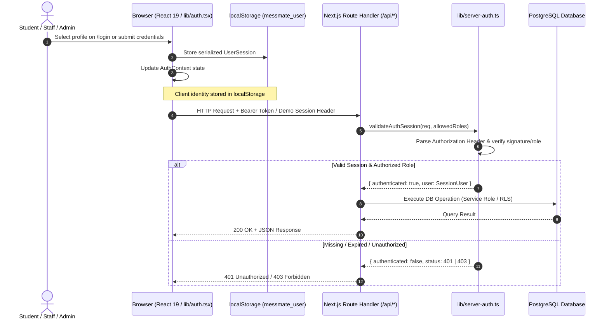

# 07 — Authentication, Authorization & Security Architecture

This document provides a comprehensive, rigorous breakdown of MessMate's authentication, authorization, cryptographic verification, and defense-in-depth threat models.

---

## 1. Authentication Architecture: Client vs. Server

MessMate implements a hybrid authentication and identity model designed for rapid campus usability, deterministic testing, and secure API validation.



### 1.1 Client-Side State: `lib/auth.tsx`

- **State Container:** `AuthContext` provides `user`, `role`, `login()`, `logout()`, `switchRole()`, and `isAuthenticated`.
- **Persistence:** Synchronized with browser `localStorage` under the key `messmate_user`.
- **Demo Mode Profiles:** Pre-configured profiles (`student-1`, `staff-1`, `admin-1`) allow instant role-switching during demonstrations and hackathon evaluations without requiring external OAuth redirection delays.
- **Client Route Protection:** Student, Staff, and Admin dashboard pages check `user` and `role` on mount. If unauthenticated or role-mismatched, the user is redirected via `useRouter` to `/login`.

### 1.2 Server-Side Verification: `lib/server-auth.ts`

Client-side checks alone are never trusted. All mutation and query routes in `/api/` invoke `validateAuthSession(req, allowedRoles)`:
- Extracts either `Authorization: Bearer <token>` or session context headers.
- Inspects cryptographic validity, session expiration, and role permissions against `allowedRoles: ("STUDENT" | "STAFF" | "ADMIN")[]`.
- Returns an explicit 401 if unauthenticated, or 403 if authenticated but lacking the required privilege (e.g., student attempting to call `/api/qr/verify` or `/api/meals` POST).

---

## 2. Secrets Management & Key Separation

A critical security principle implemented in MessMate is **strict key privilege separation**:

| Key Name | Location & Scope | Exposed to Client? | Purpose |
| :--- | :--- | :--- | :--- |
| `NEXT_PUBLIC_SUPABASE_URL` | Public / Browser & Server | **Yes** (Bundled in client JS) | Endpoint for Supabase client connection |
| `NEXT_PUBLIC_SUPABASE_ANON_KEY` | Public / Browser & Server | **Yes** (Bundled in client JS) | Client reads subject to Row-Level Security (RLS) |
| `SUPABASE_SERVICE_ROLE_KEY` | Server-Only (`.env.local`) | **NO** (Strictly forbidden on client) | Administrative database bypass for verified API endpoints |
| `HMAC_SECRET` | Server-Only (`.env.local`) | **NO** (Guarded with `import "server-only"`) | Generates & verifies SHA-256 signatures for QR meal passes |

### The `import "server-only"` Guardrail

In `lib/crypto.ts` and `lib/server-auth.ts`, the file begins with:
```typescript
import "server-only";
```
If any developer mistakenly attempts to import `lib/crypto.ts` or server auth modules into a React client component (`"use client"`), the Next.js compiler immediately halts the build with a fatal compilation error, preventing accidental credential exposure.

---

## 3. Row-Level Security (RLS) Policies

Database security is enforced in PostgreSQL via `supabase/migrations/002_security_rls.sql`:

1. **`users` Table:**
   - Public read access for profile discovery within hostel boundary.
   - Users can only update their own records (`auth.uid() = id`).
   - Admins hold full update and delete rights.
2. **`meal_slots` Table:**
   - Read access granted to all authenticated users (students need to see menus and slots).
   - Insert, update, and delete restricted exclusively to `ADMIN` roles.
3. **`meal_bookings` Table:**
   - Students can `SELECT` only bookings where `user_id = auth.uid()`.
   - Students can `INSERT` and `UPDATE` bookings only where `user_id = auth.uid()`.
   - Staff can `SELECT` and `UPDATE` (redeem) bookings during active meal slots.
   - Admins can view all bookings across the hostel for analytics.

---

## 4. Threat Models & Defense Strategies

### Threat 1: Replay Attack (Screenshotting / Sharing QR Code)
- **Vector:** Student takes a screenshot of their valid QR code and sends it via WhatsApp to a friend who opted out.
- **Defense:**
  1. The QR payload contains a timestamp `t` and is valid only within a rotating 30-second epoch window (`t_now - t <= 30s`).
  2. The staff scanner verifies the timestamp and cryptographic signature. An expired screenshot is instantly rejected with `QR expired`.
  3. Once redeemed, the database record status changes to `CONSUMED`. Even if scanned within the 30-second window, a second scan fails double-redemption checks.

### Threat 2: Token Forgery
- **Vector:** An attacker analyzes the QR string `student-1:slot-uuid:1793200000:signature` and attempts to generate tokens for unregistered students or future meals.
- **Defense:**
  - The signature is calculated as `HMAC-SHA256(student-1:slot-uuid:timestamp, HMAC_SECRET)`.
  - Without knowledge of `HMAC_SECRET` (which never leaves the server), calculating a valid signature is computationally infeasible ($2^{256}$ keyspace).

### Threat 3: Double-Scanning (Race Condition / Concurrent Scanners)
- **Vector:** A student presents the same QR code to two different mess staff scanning lines at the exact same millisecond.
- **Defense:**
  - Handled via SQL Atomic Compare-And-Swap (CAS):
    ```sql
    UPDATE meal_bookings
    SET status = 'CONSUMED', scanned_at = NOW(), scanned_by = $staff_id
    WHERE user_id = $student_id
      AND meal_slot_id = $slot_id
      AND status IN ('LOCKED', 'OPTED_IN')
    RETURNING id;
    ```
  - The database guarantees transaction serialization. Exactly one transaction will update the row (rows affected = 1) and return success; the concurrent transaction finds 0 rows matching status `IN ('LOCKED', 'OPTED_IN')` and aborts with `409 Already Consumed`.

### Threat 4: Session & Role Impersonation
- **Vector:** A student manipulates `localStorage.messmate_user` to change `"role": "STUDENT"` to `"role": "ADMIN"` to access the admin portal.
- **Defense:**
  - Client navigation may display the admin UI shell, but all data fetching calls (`/api/rebates`, `/api/meals`, `/api/qr/verify`) validate server authorization.
  - The API extracts the real role or verifies the user against the database before executing any privileged query. Unauthorized attempts return HTTP 403.

### Threat 5: Offline Sync Poisoning
- **Vector:** A malicious actor attempts to inject arbitrary scans into `/api/qr/sync` pretending they were scanned offline.
- **Defense:**
  - `/api/qr/sync` requires `STAFF` or `ADMIN` authentication.
  - Every individual queued scan must contain a valid HMAC signature calculated over its specific student ID, slot ID, and offline timestamp.
  - Timestamps must fall within the designated serving window for that meal slot.

---

## 5. Security Limitations & Production Hardening

In academic viva and evaluation settings, clearly stating current trade-offs demonstrates senior engineering maturity:

1. **Current Implementation:**
   - Uses demo profile switching and Bearer header tokens to facilitate fast evaluation.
   - Tokens stored in `localStorage` are vulnerable to Cross-Site Scripting (XSS) if untrusted third-party scripts run in the DOM.
2. **Production Roadmap (Bank-Grade / Enterprise):**
   - **HttpOnly, Secure, SameSite=Lax Cookies:** Mitigates XSS token extraction.
   - **OAuth 2.0 / OpenID Connect (OIDC):** Integration with MNNIT Institutional LDAP / Google Workspace SSO.
   - **Distributed Rate Limiting:** Redis-backed sliding window rate limiter (e.g., Upstash) on `/api/qr/verify` and `/api/auth/register` to prevent brute-force attacks.
