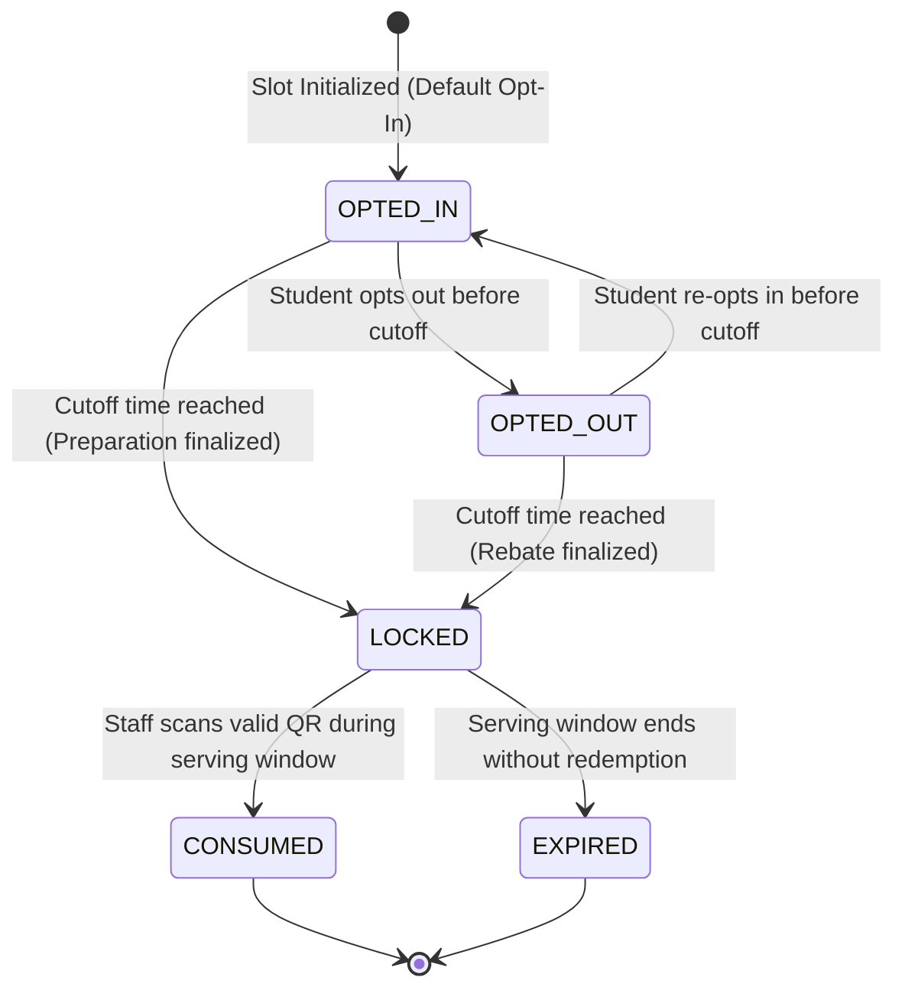

# 09 — Business Logic, State Machines & Institutional Rules

This document details the core domain rules, finite state machines (FSM), timing policies, and mathematical accounting models that govern the MessMate system for MNNIT Allahabad hostels.

---

## 1. Meal Booking Finite State Machine (FSM)

The meal booking lifecycle progresses through strictly validated state transitions to ensure auditability, cutoff enforcement, and double-redemption prevention.



### State Definitions & Permitted Transitions

| State | Description | Permitted Next States | Trigger / Condition |
| :--- | :--- | :--- | :--- |
| **`OPTED_IN`** | Active booking. Student is counted in kitchen prep metrics. | `OPTED_OUT`, `LOCKED` | Student toggle before cutoff OR cutoff timestamp passed. |
| **`OPTED_OUT`** | Student notified mess they will not attend. Rebate credited. | `OPTED_IN`, `LOCKED` | Student toggle before cutoff OR cutoff timestamp passed. |
| **`LOCKED`** | Cutoff passed. Student choices cannot be altered. | `CONSUMED`, `EXPIRED` | QR scan at entrance OR serving window elapses. |
| **`CONSUMED`** | Meal successfully redeemed at counter. Terminal state. | *None* | Verified counter scan (Atomic CAS update). |
| **`EXPIRED`** | Meal was booked (`OPTED_IN`) but never claimed. | *None* | Window closes; meal counted as prepared food waste. |

---

## 2. Institutional Timing Rules & Cutoff Logic

Mess catering requires advance planning for procurement, vegetable chopping, and grain soaking. MessMate enforces deterministic cutoffs per meal type:

| Meal Type | Serving Window | Cutoff Time | Enforced Cutoff Rule |
| :--- | :--- | :--- | :--- |
| **BREAKFAST** | 07:30 – 10:30 IST | 08:30 IST | Same-day morning operational freeze (or prior night) |
| **LUNCH** | 12:00 – 14:30 IST | 12:00 IST | Preparation headcount finalized at noon |
| **DINNER** | 19:30 – 22:00 IST | 19:00 IST | Evening preparation finalized 30 minutes prior |

### Serving Window Evaluation (`lib/meal-times.ts`)

A meal is marked as actively serving if:
$$\text{startTime} \le \text{currentTime} \le \text{endTime}$$

Cutoff status is evaluated as:
$$\text{isCutoffPassed} = \text{currentTime} \ge \text{cutoffTime}$$

Once `isCutoffPassed === true`:
- The client UI disables the toggle switch with an informational tooltip.
- The server `/api/meals` route handler rejects incoming mutation requests with `400 Bad Request`.
- Kitchen headcount metrics transition from "Forecast" to "Committed Rations".

---

## 3. Dynamic Rebate Ledger & Accounting Mathematics

Mess fees at MNNIT are collected per semester or per month. When students miss meals (due to holidays, internships, or dining elsewhere), calculating rebates manually through paper slips leads to administrative disputes and delayed refunds.

MessMate models rebates as an automated accounting ledger (`lib/rebates.ts`):

### Mathematical Formulation

1. **Base Monthly Fee ($F_{\text{base}}$):**
   $$F_{\text{base}} = ₹4,500$$

2. **Per-Meal Unit Credit ($C_{\text{unit}}$):**
   $$C_{\text{unit}} = ₹50$$

3. **Total Rebate Credit ($R_{\text{total}}$):**
   For $N$ successfully opted-out meals within the billing cycle $[D_{\text{start}}, D_{\text{end}}]$:
   $$R_{\text{total}} = \sum_{i=1}^{N} C_{\text{unit}}(i) = N \times ₹50$$

4. **Net Payable Amount ($A_{\text{net}}$):**
   $$A_{\text{net}} = \max\left(0,\, F_{\text{base}} - R_{\text{total}}\right)$$

### Key Accounting Invariants

- **Non-Negative Invariant:** $A_{\text{net}} \ge 0$. Under no circumstance can a student's mess bill become negative (rebate cannot exceed total monthly base fees).
- **Cutoff Guarantee:** Only meals opted out *before* the cutoff qualify for rebate credits. If a student skips a meal without opting out, the meal transitions to `EXPIRED` and ₹0 rebate is awarded (as the mess already incurred procurement and preparation expenses).

---

## 4. Timezone & Virtual Server Clock Logic

### Timezone Normalization
All calendar boundary calculations, date formatting, and cutoff checks use `INSTITUTIONAL_TIMEZONE = "Asia/Kolkata"` (UTC+05:30).
Using UTC directly would cause midnight roll-over bugs at 05:30 AM local time, misattributing breakfast slots to the wrong calendar date.

```typescript
// Explicit timezone formatting in lib/rebates.ts
const parts = new Intl.DateTimeFormat("en-US", {
  timeZone: "Asia/Kolkata",
  year: "numeric",
  month: "numeric",
}).formatToParts(referenceDate);
```

### Virtual Clock Architecture (`lib/server-clock.ts`)

In production, `getServerNow()` returns `new Date()`. For demonstrations, automated test suites, and academic viva evaluations, MessMate provides a virtual clock controller:
- Supports simulated time offsets: `offsetMs`.
- Enables live demonstration of cutoff transitions, midnight month rollovers, and active serving windows without waiting for real-world hours to pass.
- Accessible via `/api/dev/time` and the in-app Dev Testing Drawer.

---

## 5. Architectural Enforcement Summary

| Business Rule | Enforced in Client | Enforced in API Route | Enforced in Database |
| :--- | :--- | :--- | :--- |
| **Cutoff Lock** | UI Toggle Disabled | `400 Bad Request` check | Status check on update |
| **Double Redemption** | Scanner debounce | Signature validation | SQL CAS `RETURNING id` |
| **Role Authorization** | UI route redirect | `validateAuthSession` | Supabase RLS Policies |
| **Rebate Non-Negative** | Visual fee cap | `Math.max(0, ...)` | Domain boundary validation |
| **QR Expiry** | 30s countdown bar | Timestamp delta check | Stored `scanned_at` record |
