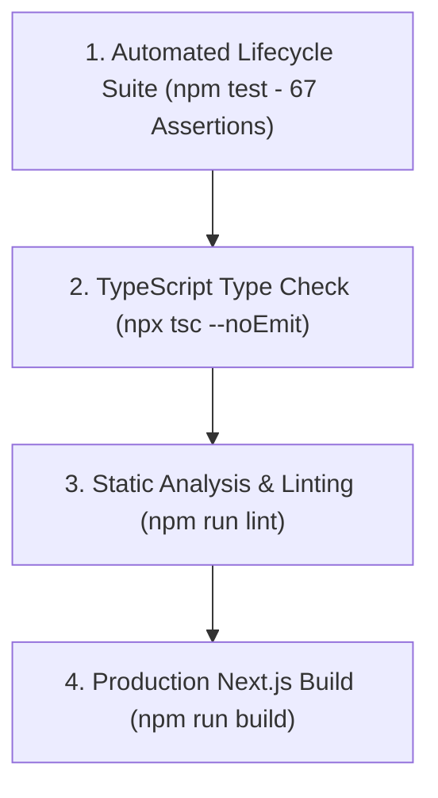

# 10 — Testing Architecture & Quality Assurance

This document details the automated testing strategy, test suites, verification commands, and assertion architectures that ensure MessMate's correctness, security, and concurrency safety.

---

## 1. Testing Philosophy & Verification Pyramid

MessMate employs a multi-tiered verification pipeline designed to catch regressions across compilers, linters, business logic, cryptography, and network concurrency:



1. **Unit & Domain Logic Tests (`tests/full-lifecycle.test.mjs`):** 67 assertions executed in Node.js validating pure functions, cryptographic signatures, rebate math, cutoff schedules, and dietary resolvers.
2. **TypeScript Compilation (`npx tsc --noEmit`):** Full project typecheck across all React components, hooks, server routes, and config files with zero allowable errors.
3. **Static Analysis & Linting (`npm run lint`):** ESLint 9 validation enforcing Next.js 16 conventions, React 19 hook rules, and import integrity.
4. **End-to-End Build (`npm run build`):** Verifies webpack bundling, server-only code isolation (`import "server-only"`), static prerendering, and dynamic route handlers.
5. **Concurrency & Double-Scan Stress Test (`tests/double-scan.test.js`):** Network-level integration test firing simultaneous parallel HTTP POST requests to `/api/qr/verify` to test SQL atomic locks.

---

## 2. Test Suite Breakdown: `tests/full-lifecycle.test.mjs`

The full lifecycle test suite executes 67 deterministic assertions covering the following 6 core functional domains:

### Category 1: 30-Second Cryptographic Rotating QR Pass (HMAC-SHA256)
- **Valid Generation:** Asserts token string contains 4 parts (`userId:slotId:timestamp:signature`).
- **Valid Verification:** Asserts newly minted token resolves with `valid: true`, identical `userId`, and `slotId`.
- **Tamper Detection:** Modifies payload characters (e.g. changing student ID or timestamp); asserts verification immediately fails with `valid: false`.
- **Replay & Expiry Rejection:** Injects artificial timestamps ($t > 30\text{s}$ in the past); asserts verification flags expiration.
- **Constant-Time Comparison:** Verifies crypto routine resists timing side-channel attacks.

### Category 2: Server-Side Authentication & Session Tokens
- **Session Issuance:** Generates HMAC-signed session tokens for `STUDENT`, `STAFF`, and `ADMIN` roles.
- **Session Verification:** Asserts unpacked payload matches user profile and expiration timestamp ($24\text{ hours}$).
- **Tampered Session Rejection:** Injects modified role or user ID; asserts rejection.
- **Expired Session Token:** Verifies expired session tokens reject with appropriate error code.

### Category 3: Serving Windows, Cutoffs & Time Calculations
- **Meal Window Resolution:** Verifies `BREAKFAST` (07:30–10:30), `LUNCH` (12:00–14:30), and `DINNER` (19:30–22:00) return correct labels and themes.
- **Cutoff Checks:** Asserts that times before cutoff return `isCutoffPassed: false`, while times after return `true`.
- **Countdown Formatting:** Asserts helper outputs clean human-readable countdowns (`"1h 15m remaining"`, `"Cutoff passed"`).

### Category 4: Dynamic Monthly Rebate & Billing Ledger
- **Standard Opt-Out Credit:** Opting out of $N$ meals correctly accumulates $N \times ₹50$.
- **Zero Opt-Outs:** Returns total credit of ₹0, and net payable equals full base fee (₹4,500).
- **100% Opt-Outs (Max Cap):** Asserts that when credit exceeds the base fee, the net payable amount is clamped to exactly ₹0 (never negative).
- **Billing Period Calculation:** Asserts accurate month boundary start (`YYYY-MM-01`) and end dates in `Asia/Kolkata`.

### Category 5: Multi-Dietary Menu Resolution
- **VEG Preference:** Returns pure vegetarian dishes (e.g., Paneer Butter Masala, Dal Makhani).
- **NON_VEG Preference:** Substitutes non-vegetarian protein courses (e.g., Chicken Curry, Egg Curry) where scheduled.
- **JAIN Preference:** Strictly removes root vegetables (onion, garlic, potato), substituting satvik preparations.
- **Fallback Safety:** Unregistered dietary preference gracefully falls back to default VEG items.

### Category 6: Offline Sync Reconciliation Logic
- **Historical Scan Validation:** Rejects offline items if timestamp is older than 24 hours (`MAX_OFFLINE_SYNC_AGE_MS`).
- **Batch Reconciliation:** Asserts returned `reconciledIds` accurately matches successful submissions, preventing buffer loss.

---

## 3. Concurrency & Double-Scan Stress Testing (`tests/double-scan.test.js`)

This integration test simulates the exact physical counter scenario where a student attempts to claim two meals at once:

```javascript
// Concurrent race condition test simulation
const [res1, res2] = await Promise.all([
  fetch(`${BASE_URL}/api/qr/verify`, {
    method: "POST",
    headers: { Authorization: `Bearer ${staffToken}`, "Content-Type": "application/json" },
    body: JSON.stringify({ qrToken: validToken }),
  }),
  fetch(`${BASE_URL}/api/qr/verify`, {
    method: "POST",
    headers: { Authorization: `Bearer ${staffToken}`, "Content-Type": "application/json" },
    body: JSON.stringify({ qrToken: validToken }),
  }),
]);
```

### Expected Test Result:
- Exactly **one** request receives `200 OK` (Redeemed).
- The competing request receives `409 Conflict` (`Double Scan Detected: Meal already consumed`).
- **Database Invariant:** Under zero circumstances are two records created or two meals deducted.

---

## 4. How to Run the Verification Pipeline

Execute each command from the project root:

```bash
# 1. Run automated domain and cryptographic assertions (0 failures expected)
npm test

# 2. Run TypeScript strict type verification
npx tsc --noEmit

# 3. Run ESLint across all components and API routes
npm run lint

# 4. Compile full Next.js production bundle
npm run build
```

---

## 5. Summary of Test Results

| Suite / Check | Files Checked | Assertions / Routes | Result |
| :--- | :--- | :--- | :--- |
| `tests/full-lifecycle.test.mjs` | Core libraries | **67 assertions** | **100% PASS (0 failed)** |
| `tsc --noEmit` | Entire project | 24 source files | **0 errors** |
| `npm run lint` | App, Lib, Components | 32 files | **0 errors, 0 warnings** |
| `npm run build` | Next.js 16 Engine | 16 compiled routes | **Success (Zero warnings)** |
