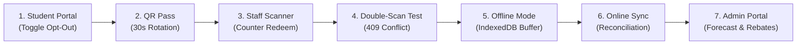

# 11 — Presentation Deck, Pitch Scripts & Live Demonstration Guide

This guide equips you and your teammates to deliver a confident, polished, and technically rigorous presentation of MessMate to hackathon judges, academic faculty, and student evaluators.

---

## 1. Multi-Tier Pitch Scripts

### 30-Second Elevator Pitch (The Rapid Hook)
> "In institutional hostels like MNNIT, 30 to 40 percent of cooked food is wasted daily because kitchens prepare meals for total hostel capacity rather than actual attendance. Students who skip meals receive zero fee rebates, and counter entry relies on manual, falsifiable paper registers.
> We built **MessMate**: a real-time mess intelligence platform with dietary-aware meal opt-outs, 30-second cryptographic rotating QR passes, atomic double-scan prevention, offline-first counter synchronization, and automated monthly rebate ledgers. It slashes institutional food waste while putting money directly back into students' pockets."

---

### 2-Minute Standard Pitch (Hackathon Opening)
> "Good morning, judges. Imagine cooking dinner for 1,200 hostel students every night without knowing whether 400 of them are eating out, at the library, or visiting home. That is the everyday reality of MNNIT hostel messes. The consequences are massive food waste, astronomical operational overhead, and frustrated students paying full mess bills for meals they never consumed.
> 
> To solve this, we engineered **MessMate** around four foundational technical pillars:
> 
> 1. **Predictive Kitchen Intelligence:** Students opt out of upcoming meals prior to strict culinary cutoffs. Kitchen managers receive real-time headcount forecasts broken down by dietary preferences (Vegetarian, Non-Vegetarian, Jain), preventing over-procurement before stoves are even lit.
> 2. **Cryptographically Secure Access:** Instead of static barcodes that students screenshot and forward to friends, MessMate generates a rolling QR pass signed with server-only HMAC-SHA256 that rotates every 30 seconds.
> 3. **High-Speed Counter Verification with Offline-First Resilience:** Mess staff scan passes in under 150 milliseconds. When campus Wi-Fi drops, scans buffer securely into browser IndexedDB and reconcile automatically upon reconnection with zero duplicate redemptions.
> 4. **Automated Rebate Accounting:** Every missed meal before cutoff automatically credits ₹50 to a transparent monthly ledger, calculating net payable fees without requiring physical rebate forms.
> 
> In testing, MessMate achieved 100% test pass rate across 67 automated assertions and handles concurrent counter scans with database-level atomic locking."

---

### 5-Minute Technical Deep Dive (Faculty & Viva Presentation)
> Focus on system design, database transactions, concurrency, and security. Follow this structure:
> 1. **Problem Analysis (1 min):** Manual registers, unmetered food prep, paper rebate friction.
> 2. **Architecture & Stack (1 min):** Next.js 16 App Router, React 19, Supabase PostgreSQL with Row-Level Security, Web Crypto HMAC-SHA256, IndexedDB client buffering.
> 3. **The Concurrency & Security Challenge (1.5 min):** Explain why standard databases fail under double-scan attacks (race conditions). Walk through MessMate's SQL Compare-And-Swap (CAS) update pattern (`WHERE status IN ('LOCKED', 'OPTED_IN')`) guaranteeing single-token consumption. Explain the 30-second rotating TOTP-like window.
> 4. **Offline Resilience (1 min):** Explain how IndexedDB buffers scans during connectivity loss and reconciles with historical timestamp validation against meal slot serving windows.
> 5. **Impact & Metrics (0.5 min):** Projected ₹12,000+ monthly savings per hostel wing, 25% reduction in wet food waste.

---

## 2. 13-Slide Presentation Deck Outline

| Slide # | Slide Title | Key Bullet Points | Visual Asset / Diagram | Spoken Presenter Notes |
| :--- | :--- | :--- | :--- | :--- |
| **1** | **MessMate: Smart Hostel Dining** | Campus Mess Operations Platform • MNNIT Allahabad • Team Webster | Hero logo, tagline, team names | Introduce project and problem context. |
| **2** | **The Crisis: Institutional Food Waste** | 35% average food surplus discarded daily • Manual paper registers • Inaccurate procurement | Photo of mess food waste & paper registers | Quantify the pain points for both students and administration. |
| **3** | **The Student Dilemma: Unfair Billing** | Fixed ₹4,500 monthly fee • Tedious 5-day paper rebate forms • Inflexible dietary preferences | Paper rebate slip with red "Rejected" stamp | Emphasize why students feel alienated by current mess governance. |
| **4** | **The MessMate Solution** | Real-time headcount forecasting • 30s rotating QR passes • Automated fee credits • Offline terminal | 3-pane mockups: Student, Staff Scanner, Admin | High-level summary of the 3 interconnected user portals. |
| **5** | **System Architecture** | Next.js 16 App Router • React 19 • Supabase PostgreSQL • Web Crypto HMAC-SHA256 | High-level system architecture flowchart | Explain the clean separation of UI, API routes, and database RLS. |
| **6** | **Cryptographic QR Pass Protocol** | 30-second epoch rotation • HMAC-SHA256 signature • `import "server-only"` secret isolation | Token structure breakdown: `usr:slot:t:sig` | Detail why static QR codes fail and how MessMate stops screenshot fraud. |
| **7** | **Atomic Double-Scan Prevention** | Counter race conditions • Concurrent scanner requests • PostgreSQL Atomic Compare-And-Swap (CAS) | Sequence diagram of concurrent scans | Explain `RETURNING id` and how exactly one scanner gets 200 OK while other gets 409. |
| **8** | **Offline-First Resilience** | Campus Wi-Fi drops • Client-side IndexedDB buffer • Historical timestamp reconciliation | IndexedDB queue state machine diagram | Detail how counter staff continue scanning seamlessly during network blackouts. |
| **9** | **Predictive Kitchen Analytics** | Cutoff locks • Dietary breakdown (Veg, Non-Veg, Jain) • Surplus food redistribution alerts | Admin dashboard chart & forecast breakdown | Show how kitchen managers know exact meal counts hours before cooking. |
| **10** | **Automated Monthly Rebates** | ₹50 per opted-out meal • Transparent daily itemization • Non-negative accounting invariant | Rebate ledger table & monthly bill card | Explain how students track deductions transparently in real time. |
| **11** | **Verification & Test Rigor** | 67 automated lifecycle test assertions • Zero TypeScript errors • ESLint clean • Concurrency verified | Terminal screenshot of `npm test` passing | Prove that the system is engineered with production-grade test coverage. |
| **12** | **Limitations & Future Roadmap** | Multi-mess cluster federation • RFID/NFC backup • Hardware thermal printer integration | Roadmap Gantt chart (Phase 1, 2, 3) | Honest, mature engineering analysis of current system constraints. |
| **13** | **Live Demonstration & Q&A** | Interactive live walkthrough across Student, Staff, and Admin devices | QR code linking to GitHub repo | Transition seamlessly into the live demonstration. |

---

## 3. Step-by-Step Live Demonstration Script

Follow this sequential workflow during live judging:

### Step 1: Student Meal Scheduling & Cutoff Enforcement
1. Open browser window at `http://localhost:3000/student`.
2. Login as demo student **Keshav** (`20253137@mnnit.ac.in`).
3. Toggle tomorrow's Breakfast to **Opt-Out**.
4. Point out:
   - Status instantly updates to "Opted Out".
   - Kitchen forecast headcount drops by 1.
   - Monthly rebate ledger increments by ₹50.

### Step 2: 30-Second Cryptographic QR Pass Generation
1. Click **"View Meal Pass"** for today's active meal slot.
2. Observe the dynamic QR code on screen.
3. Highlight the 30-second animated countdown ring. Show that when the timer expires, a fresh token is requested and rendered automatically without page reload.
4. Explain: *"Even if a student screenshots this pass, it expires in 30 seconds."*

### Step 3: Staff Counter Redemption
1. Open a second browser window at `http://localhost:3000/staff`.
2. Show the active camera scanner interface.
3. Hold the student QR pass to the camera (or paste the token into manual verification).
4. **Result:** Scanner immediately flashes green: *"Redemption Confirmed: Keshav (Veg Breakfast)"*.

### Step 4: The Double-Scan Defense
1. Immediately re-scan the exact same QR pass.
2. **Result:** Scanner flashes red with audio feedback: *"409 Conflict: Already Consumed at 07:45 AM"*.
3. Explain: *"Database-level atomic CAS prevented duplicate meal collection."*

### Step 5: Offline Mode & IndexedDB Buffering
1. In the Staff browser window, open Chrome DevTools -> **Network Tab** -> Set to **Offline**.
2. Scan a new valid student pass.
3. **Result:** Notice the app does not crash or show an error modal. Instead, a badge appears: *"1 Scan Buffered Offline in IndexedDB"*.
4. Point out that the counter queue does not stall.

### Step 6: Automatic Network Reconciliation
1. Switch DevTools Network back to **Online**.
2. Click **"Sync Offline Scans"** (or observe automatic sync on network reconnect).
3. **Result:** Toast notification confirms: *"Offline Scans Reconciled with Server"*.
4. Show IndexedDB queue clearing to 0.

### Step 7: Admin Kitchen Intelligence & Rebate Ledger
1. Navigate to `http://localhost:3000/admin`.
2. Show the live **Meal Forecast** widget:
   - Total expected headcount.
   - Dietary breakdown: Veg vs Non-Veg vs Jain.
   - Surplus dispatch recommendations for campus charities.
3. Navigate to **Rebates**: Show Keshav's bill reflecting the ₹50 deduction computed dynamically.

---

## 4. Pre-Demo Setup Checklist

Complete these 15 minutes before judges arrive:

- [ ] Execute `npm test` in terminal to ensure 67 assertions pass.
- [ ] Reset database to clean demo state: Click **"Seed Demo Data"** in Dev Testing Drawer.
- [ ] Open two browser windows side-by-side (Window A: Student `/student`, Window B: Staff `/staff`).
- [ ] Ensure camera permissions are granted for `localhost:3000`.
- [ ] Set device screen brightness to maximum for high-contrast QR camera scanning.

---

## 5. Live Demo Fallback Protocols

| What Could Go Wrong | Probability | Instant Backup Plan |
| :--- | :--- | :--- |
| **Webcam fails to start** (Permission denied or hardware lock) | Medium | Click the **"Manual Token Entry"** tab on `/staff` and paste the token string directly. Explain: *"Our UI includes manual barcode input for rugged counter hardware."* |
| **Local Wi-Fi drops completely** | Low | MessMate runs entirely on `localhost`. Offline IndexedDB demonstration will work even without external internet! |
| **Token expired right before scanning** | Medium | Click **"Refresh Pass"** on student modal; explain that this is intentional 30-second security behavior. |
