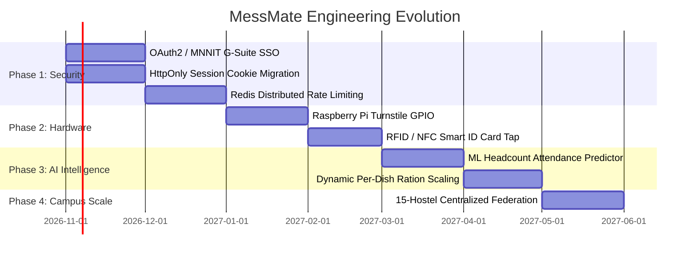

# 14 — System Limitations, Technical Debt & Future Engineering Roadmap

Every genuine engineering project involves conscious trade-offs. This document provides an honest appraisal of MessMate's current limitations, edge-case failure modes, and a structured multi-phase enhancement roadmap.

---

## 1. Honest Technical Debt & System Limitations

### 1.1 Client Identity & Session Storage
- **Current State:** Active session identity is stored in browser `localStorage` (`messmate_user`), accompanied by demo profile switching.
- **Limitation:** `localStorage` is vulnerable to Cross-Site Scripting (XSS) if untrusted scripts run in the DOM.
- **Production Remedy:** Transition to `HttpOnly`, `Secure`, `SameSite=Lax` cookies with server-issued JWTs, combined with MNNIT Institutional LDAP / Google OAuth 2.0.

### 1.2 Distributed Offline Scans Across Disconnected Terminals
- **Current State:** Each staff counter terminal buffers offline scans in its local IndexedDB database.
- **Limitation (CAP Theorem AP):** If two staff members simultaneously disconnect their laptops from Wi-Fi and operate in isolation, an attacker could present the same QR code to Terminal A and Terminal B within 30 seconds. Both terminals would record the scan locally. When reconnected, the server flags the duplicate during reconciliation, but the student has already entered.
- **Mitigation:** In physical mess operations, students are assigned to designated counter lanes or turnstiles, preventing cross-lane double scanning. Reconciled audit logs flag offending students for disciplinary action.

### 1.3 In-Memory Virtual Clock
- **Current State:** Simulated clock offsets (`lib/server-clock.ts`) are stored in server process memory.
- **Limitation:** In a multi-instance autoscaled deployment (e.g. 5 Kubernetes pods), clock offsets would not be synchronized across pods unless backed by Redis or an external state store.
- **Context:** The virtual clock is intended exclusively for development, evaluation, and test suites, not production multi-region clusters.

### 1.4 Manual Counter Validation vs. Automated Turnstiles
- **Current State:** A mess staff member holds a mobile phone or laptop camera to scan student passes and inspects the screen for green/red validation.
- **Limitation:** Human error (staff waving students through without looking) remains possible during extreme rush periods.
- **Production Remedy:** Hardware integration with physical solenoid turnstiles or NFC smart card readers.

### 1.5 Dynamic Catering Edge Cases
- **Current State:** Rebates model a fixed base fee (₹4,500/month) and fixed meal deductions (₹50/meal).
- **Limitation:** Does not currently support guest meal coupon purchasing, festival banquet surcharges, or mid-month hostel transfers.

---

## 2. Multi-Phase Engineering Roadmap

### Phase 1: Security Hardening & Enterprise SSO (Months 1–2)
1. **MNNIT Institutional Single Sign-On:** Integrate Google Workspace OAuth 2.0 restricted to `@mnnit.ac.in` domain.
2. **HttpOnly Cookie Architecture:** Replace `localStorage` session handling with cryptographically signed, secure cookies.
3. **Distributed Rate Limiting:** Implement Upstash Redis sliding window rate limits (10 req/s on `/api/qr/verify`).

### Phase 2: Hardware & Edge Terminal Integration (Months 3–4)
1. **IoT Turnstile Integration:** Deploy Raspberry Pi 4 edge controllers with GPIO relays wired to physical cafeteria turnstiles.
2. **NFC / RFID Card Support:** Add dual-interface scanners supporting both 30s QR codes and MNNIT contactless student ID cards (MIFARE Classic / DESFire).
3. **Thermal Receipt Printing:** Add optional micro-thermal printer output for special dietary tokens (e.g. Jain or non-veg counters).

### Phase 3: AI-Driven Predictive Kitchen Analytics (Months 5–6)
1. **Machine Learning Headcount Forecasting:** Train time-series models (e.g. Prophet / XGBoost) on historical attendance, factoring in academic calendar events (end-term exams, festivals, sports fests) and local weather.
2. **Automated Procurement Purchase Orders:** Connect committed headcount forecasts directly to raw material inventory calculations (e.g. calculating exact kilograms of rice, dal, and vegetables required).

### Phase 4: Campus-Wide Multi-Hostel Federation (Months 7–8)
1. **Multi-Tenant Architecture:** Partition the database by `hostel_id` across all MNNIT hostels (SVBH, Tandon, Malaviya, Tilak, Patel, Raman, etc.).
2. **Chief Warden / Dean of Student Welfare Dashboard:** University-wide analytics tracking food waste reduction, budget efficiency, and vendor quality ratings across all campus messes.
