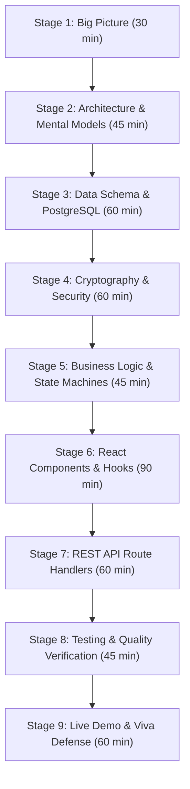

# 15 — Progressive 9-Stage Learning Roadmap

This roadmap outlines a structured, 9-stage study program to help any student or developer master the complete MessMate codebase, from high-level product concepts down to low-level cryptographic bitwise operations.

---

## Roadmap Overview

---

## Stage 1: The Big Picture & Product Foundation
- **Estimated Time:** 30 minutes
- **Learning Objectives:** Understand the institutional problem in MNNIT hostel dining halls, quantify food waste metrics, and articulate the four core solutions.
- **Documents to Read:** `docs/project-learning/00-project-overview.md`
- **Practical Exercise:** Deliver the 30-second elevator pitch out loud to a teammate without looking at notes.

---

## Stage 2: System Architecture & Visual Mental Models
- **Estimated Time:** 45 minutes
- **Learning Objectives:** Visualize the flow of requests from browser to Next.js route handlers and Supabase PostgreSQL; understand role isolation.
- **Documents to Read:** `docs/project-learning/01-architecture-and-system-design.md`
- **Key Files to Inspect:** `app/layout.tsx`, `config/constants.ts`
- **Practical Exercise:** Draw the 3-portal architecture (Student, Staff, Admin) on a whiteboard or piece of paper from memory.

---

## Stage 3: The Data Layer & PostgreSQL Schema
- **Estimated Time:** 60 minutes
- **Learning Objectives:** Master the 3 core tables (`users`, `meal_slots`, `meal_bookings`), table constraints, unique keys, indices, and Row-Level Security policies.
- **Documents to Read:** `docs/project-learning/04-database-and-data-model.md`
- **Key Files to Inspect:** `supabase/migrations/001_initial_schema.sql`, `supabase/migrations/002_security_rls.sql`
- **Practical Exercise:** Explain why the unique constraint `UNIQUE(user_id, meal_slot_id)` is critical for database integrity.

---

## Stage 4: Cryptography, HMAC & QR Security
- **Estimated Time:** 60 minutes
- **Learning Objectives:** Master the mathematical structure of the 4-part QR token, HMAC-SHA256 signing, constant-time verification, and the 30-second rotating time window.
- **Documents to Read:** `docs/project-learning/06-qr-security-and-offline-system.md`, `docs/project-learning/07-authentication-authorization-and-security.md`
- **Key Files to Inspect:** `lib/crypto.ts`, `lib/server-auth.ts`
- **Practical Exercise:** Explain how constant-time comparison prevents timing side-channel attacks during token validation.

---

## Stage 5: Domain Business Logic & State Machines
- **Estimated Time:** 45 minutes
- **Learning Objectives:** Master meal booking states (`OPTED_IN` $\to$ `LOCKED` $\to$ `CONSUMED`), meal cutoff schedules (08:30 / 12:00 / 19:00), and dynamic monthly rebate accounting.
- **Documents to Read:** `docs/project-learning/09-business-logic-state-machines.md`
- **Key Files to Inspect:** `lib/rebates.ts`, `lib/meal-times.ts`, `lib/menus.ts`
- **Practical Exercise:** Calculate the net bill manually for a student who opted out of 14 meals in October, applying the ₹4,500 base fee and ₹50 meal credit.

---

## Stage 6: Codebase Navigation & React 19 Frontend
- **Estimated Time:** 90 minutes
- **Learning Objectives:** Trace component hierarchies across the three portals; understand custom React hooks (`useStudentMeals`, `useCameraScanner`, `useOfflineSync`, `useAdminData`).
- **Documents to Read:** `docs/project-learning/02-complete-codebase-walkthrough.md`, `docs/project-learning/05-feature-by-feature-working.md`
- **Key Files to Inspect:** `app/student/page.tsx`, `app/staff/page.tsx`, `app/admin/page.tsx`, `hooks/`
- **Practical Exercise:** Explain how `useCameraScanner` manages camera lifecycles and cleans up resources on component unmount.

---

## Stage 7: REST API Route Handlers & Server Authorization
- **Estimated Time:** 60 minutes
- **Learning Objectives:** Understand the mechanics of all 9 Next.js route handlers, input validation, role checks, and error responses.
- **Documents to Read:** `docs/project-learning/08-api-reference.md`
- **Key Files to Inspect:** `app/api/qr/verify/route.ts`, `app/api/meals/route.ts`, `app/api/rebates/route.ts`
- **Practical Exercise:** Trace an incoming `POST /api/qr/verify` request step-by-step from JSON parsing to atomic SQL CAS execution.

---

## Stage 8: Testing & Quality Assurance Rigor
- **Estimated Time:** 45 minutes
- **Learning Objectives:** Run and understand the 67 automated assertions in `tests/full-lifecycle.test.mjs`, static lint checks, and concurrency testing.
- **Documents to Read:** `docs/project-learning/10-testing-and-quality-assurance.md`
- **Key Files to Inspect:** `tests/full-lifecycle.test.mjs`, `tests/double-scan.test.js`
- **Practical Exercise:** Run `npm test`, `npx tsc --noEmit`, and `npm run lint` in your terminal and verify that all pass with zero errors.

---

## Stage 9: Live Demo Mastery & Viva Defense
- **Estimated Time:** 60 minutes
- **Learning Objectives:** Rehearse the 7-step live demonstration workflow; practice answering high-yield questions from the 90-question viva bank.
- **Documents to Read:** `docs/project-learning/11-presentation-and-live-demo.md`, `docs/project-learning/12-viva-question-bank.md`, `docs/project-learning/18-quick-reference.md`
- **Practical Exercise:** Perform a complete live demonstration on your laptop while talking through every screen transition out loud.
