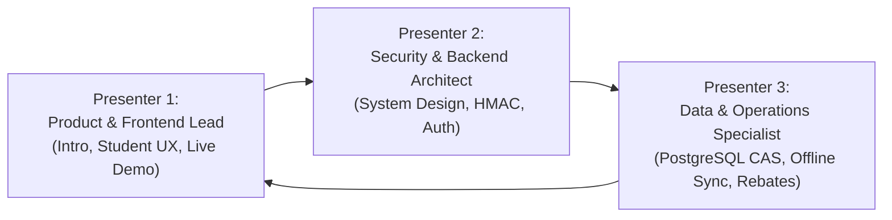

# 16 — Teammate Teaching Guide & Presentation Role Division

This guide is designed for pair and team presentations, helping you divide presentation responsibilities, explain complex engineering concepts using memorable analogies, and handle judge Q&A collaboratively.

---

## 1. Team Role Division (3-Presenter Model)

To deliver a coordinated, professional presentation without interrupting one another, divide the 10-minute presentation and live demo among three distinct roles:

### Presenter 1: Product Lead & Frontend Specialist
- **Focus:** The institutional problem, student pain points, UI/UX design, and driving the live software demonstration.
- **Speaks On:**
  - Opening hook and food waste statistics at MNNIT.
  - Student dashboard walkthrough (meal scheduling, dietary preferences).
  - Operating the live demo (toggling meals, displaying QR pass, switching roles).
  - Closing remarks and user impact.
- **Owns Viva Questions On:** React 19, Next.js routing, Tailwind CSS design tokens, accessibility, and user interaction patterns.

### Presenter 2: Security & Backend Systems Architect
- **Focus:** System architecture, cryptographic guarantees, authentication boundaries, and API routes.
- **Speaks On:**
  - High-level system architecture and Next.js App Router route handlers.
  - The 30-second rotating cryptographic QR pass protocol.
  - HMAC-SHA256 signature verification and `import "server-only"` secret isolation.
  - Mitigating screenshot sharing, token replay, and tampering.
- **Owns Viva Questions On:** Cryptography, token lifecycles, REST API endpoints, threat modeling, and timing side-channel attacks.

### Presenter 3: Database & Operations Specialist
- **Focus:** Relational data models, database concurrency, offline synchronization, and financial accounting.
- **Speaks On:**
  - Supabase PostgreSQL schema, indices, and Row-Level Security (RLS).
  - Preventing double-scanning via Atomic Compare-And-Swap (CAS) SQL updates.
  - Offline counter scanning resilience using client IndexedDB buffering.
  - Automated monthly rebate ledgers and non-negative financial bounds.
  - Automated testing rigor (67 passing assertions in `tests/full-lifecycle.test.mjs`).
- **Owns Viva Questions On:** SQL queries, race conditions, IndexedDB lifecycle, CAP theorem trade-offs, and test assertions.

---

## 2. High-Impact Analogies for Viva & Judge Explanations

When judges or faculty ask you to explain complex technical concepts, anchor your answer with an intuitive analogy before diving into code:

| Technical Concept | Real-World Analogy | How to Explain to Judges |
| :--- | :--- | :--- |
| **30-Second Rotating QR Code** | **Google Authenticator (TOTP) for Meals** | *"Just like Google Authenticator or your banking OTP changes every 30 seconds so nobody can reuse it, our QR pass re-signs with current epoch time so students cannot screenshot and share it."* |
| **Atomic Compare-And-Swap (CAS)** | **Cinema Seat Booking** | *"If two people click 'Book' on the last cinema seat at the exact same millisecond, the database must grant it to exactly one person. Our SQL query updates the booking only if status is still locked or opted in, preventing double consumption."* |
| **Offline IndexedDB Buffering** | **Airplane Flight Data Recorder (Black Box)** | *"When an airplane is mid-air without cellular data, it doesn't stop recording; it stores all flight data locally. When it lands, everything reconciles with ground control. Similarly, our counter scanner buffers scans in IndexedDB and syncs when Wi-Fi returns."* |
| **Meal Cutoff Lock** | **Airport Boarding Gate Closure** | *"You cannot board an airplane after the gate closes because baggage and fuel are already finalized. In the same way, once 08:30 AM arrives, student choices are locked so chefs can begin cooking without sudden attendance spikes."* |
| **Dynamic Monthly Rebate** | **Smart Prepaid Electricity Meter** | *"Instead of filing endless paper complaints at the end of the semester to get refunded for missed meals, MessMate acts like a smart meter: every missed meal before cutoff automatically credits ₹50 back to your balance."* |

---

## 3. Team Ownership Matrix for Judge Q&A

When a judge asks a question, use this routing table so the designated owner steps forward smoothly:

| Topic Asked by Judge | Primary Responder | Backup Responder |
| :--- | :--- | :--- |
| *"Why Next.js instead of Django/Spring?"* | Presenter 1 (Frontend Lead) | Presenter 2 (Backend Architect) |
| *"How do you prevent a student from scanning twice?"* | Presenter 3 (Database Specialist) | Presenter 2 (Backend Architect) |
| *"Can someone forge a QR code?"* | Presenter 2 (Backend Architect) | Presenter 3 (Database Specialist) |
| *"What happens when Wi-Fi drops at the mess counter?"* | Presenter 3 (Database Specialist) | Presenter 1 (Frontend Lead) |
| *"How is the rebate formula calculated?"* | Presenter 1 (Frontend Lead) | Presenter 3 (Database Specialist) |
| *"How did you verify your system before presenting?"* | Presenter 3 (Database Specialist) | Presenter 2 (Backend Architect) |
| *"What is your biggest system limitation today?"* | Any Presenter (Team Alignment) | Follow `docs/project-learning/14-limitations-and-future-roadmap.md` |

---

## 4. Teammate Peer-Check Quiz (10 Rapid Fire Questions)

Quiz each other before entering the presentation room. Every teammate should answer their assigned questions effortlessly:

1. **For Presenter 1:** *"What are the exact cutoff times for Breakfast, Lunch, and Dinner?"*
   - *Answer:* Breakfast 08:30, Lunch 12:00, Dinner 19:00 IST.
2. **For Presenter 1:** *"What happens visually on the student screen when a meal pass rotates?"*
   - *Answer:* The 30s countdown ring hits 0, a fresh token is requested from `/api/qr/token`, and the QR code re-renders instantly without a page reload.
3. **For Presenter 2:** *"What are the 4 parts of the QR token string?"*
   - *Answer:* `userId:mealSlotId:timestamp:hmacSignature`.
4. **For Presenter 2:** *"Why is `import 'server-only'` necessary in `lib/crypto.ts`?"*
   - *Answer:* To ensure `HMAC_SECRET` is never bundled into client-side JavaScript.
5. **For Presenter 2:** *"What prevents timing attacks when checking signatures?"*
   - *Answer:* Constant-time string comparison using bitwise XOR over all characters.
6. **For Presenter 3:** *"What is the exact SQL predicate used to prevent double-scanning?"*
   - *Answer:* `UPDATE meal_bookings ... WHERE status IN ('LOCKED', 'OPTED_IN') RETURNING id`.
7. **For Presenter 3:** *"What browser storage is used for offline scans, and what library accesses it?"*
   - *Answer:* IndexedDB (`messmate-offline-db`), accessed via the `idb` library.
8. **For Presenter 3:** *"How many automated assertions pass in `npm test`?"*
   - *Answer:* 67 assertions, 0 failures.
9. **For Presenter 1:** *"What is the base monthly fee and meal credit rate?"*
   - *Answer:* Base fee ₹4,500/month, rebate ₹50 per opted-out meal.
10. **For Team:** *"What is the fallback if camera permissions fail during live judging?"*
    - *Answer:* Switch instantly to the "Manual Token Entry" tab on the Staff page.
